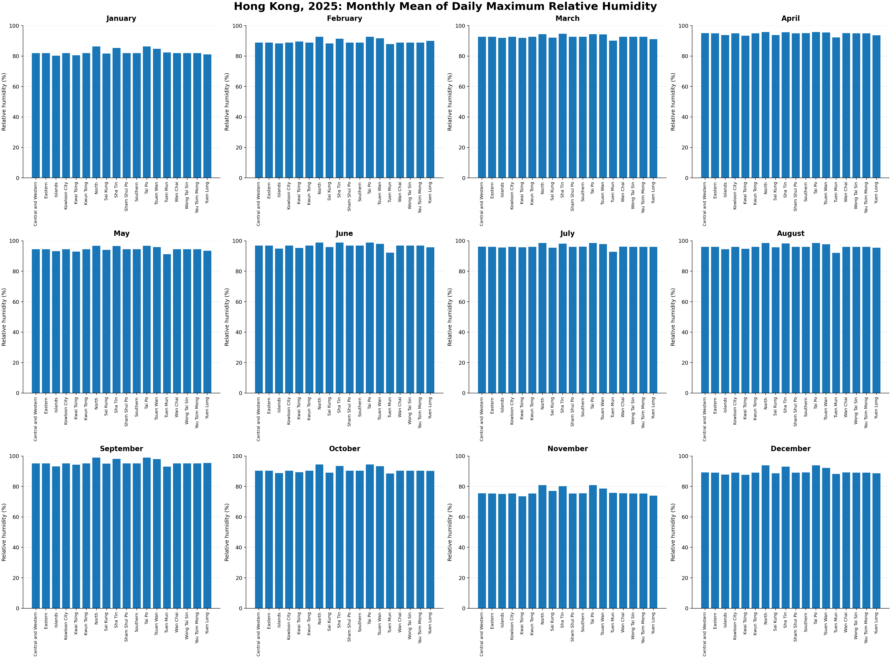

# CDS523 Case Study: Hong Kong Humidity and AQHI

**Group GC** — WU Songyuan (5550024), GUO Yuchuan (5539575)

An executed English Jupyter Notebook for the 2025 Hong Kong case study, with a
Chinese explanation and a checked execution checklist.

## Contents

| File | Purpose |
|---|---|
| [5550024_5539575_case_study.ipynb](5550024_5539575_case_study.ipynb) | Submission notebook, with code, tables, charts, map and validation outputs |
| [data.zip](data.zip) | Unmodified input: two coordinate tables and 12 monthly AQHI files |
| [phase1_monthly_humidity.png](phase1_monthly_humidity.png) | Twelve monthly humidity bar charts, with 18 districts in each |
| [phase2_hong_kong_map.html](phase2_hong_kong_map.html) | Interactive map: 18 blue district markers and 18 red AQHI station markers |
| [中文讲解与运行指南.md](中文讲解与运行指南.md) | Chinese explanation of the code, calculations, results and run instructions |
| [execution_checklist.md](execution_checklist.md) | Completed steps and verification evidence; Moodle upload remains a user action |

## Run

Use Python 3.11 or later. Keep `data.zip` beside the notebook; do not extract it.

```sh
python -m pip install -r requirements.txt
python -m notebook
```

Open `5550024_5539575_case_study.ipynb`, then select **Restart Kernel and Run All Cells**.
Every full run retrieves the 18 districts' historical humidity data online.
Phase 2 reuses that in-memory data. No external Python helper scripts are needed.

Internet access is required for Open-Meteo and the map's scripts, icons and tiles.
Trust the notebook in Jupyter to view its map. GitHub's file viewer does not run
interactive HTML: download `phase2_hong_kong_map.html` and open it in a browser.

## Statistical definitions

- Monthly humidity: mean of the daily maximum relative humidity values in that month.
- Annual humidity: mean of all 365 daily maximum values for each district.
- Annual AQHI: mean of the 365 supplied `Daily Max` values for each station.
- Annual means are not unweighted averages of monthly means.
- Weather requests use `relative_humidity_2m_max` and `Asia/Hong_Kong` local days.
- AQHI `+` and `*` annotations are removed. Empty values and `-` / `-*` markers
  become zero, following the assignment. Date and hour labels are not filled with zero.
- District and station locations remain separate and use the original supplied coordinates.

## Verification

The notebook was executed from a fresh kernel with all outputs retained:

- 6,570 daily humidity observations; 216 monthly district values.
- 365 daily AQHI rows checked against 8,760 hourly rows.
- All 6,570 station-day AQHI maxima agree with their hourly maxima.
- 14 notebook validation checks and six additional failure-path checks passed.
- All 36 real Leaflet popups and their coordinates were checked in a browser.
- Marker clicks, layer switches, zoom, and the saved notebook's embedded map passed.



Uploading this repository does not submit the assignment to Moodle. The formal
submission file is `5550024_5539575_case_study.ipynb`.
